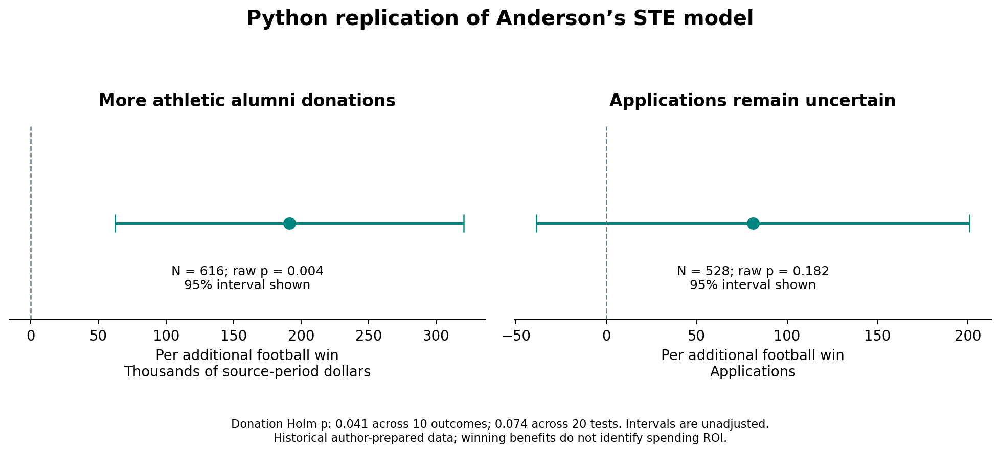

# Anderson verification and Python replication

AC 547 · Beyond the Scoreboard · Public research replication · November 11, 2026

## What this adds to our project

We obtained the public replication archive and translated the main analysis into Python. All ten sequential-treatment-effect (STE) estimates, standard errors and sample sizes match the author manuscript’s Table 3 at its displayed precision. This validates one published estimator using the author’s analytic data. The IV matching translation is close but does not fully reproduce the printed coefficients or standard errors; its discrepancies remain visible below.

The useful distinction is between the benefits of winning and the return from buying more athletic inputs. Our later-period cost-recovery analysis addresses the latter accounting relationship. Neither exercise proves that a university can purchase additional wins or earn a positive net institutional return. We keep these cohorts and estimands separate.

## Source verification: how to use Claude’s claims

The [NBER Digest](https://www.nber.org/digest/nov12/benefits-college-athletic-success) summarizes athletic alumni donations as $134,000 per win. The [2012 working paper](https://www.nber.org/system/files/working_papers/w18196/w18196.pdf) instead uses $136,400: five wins yield $682,000, approximately 28%; its accompanying illustrations are 677 applications (5%), a 1.5 percentage-point acceptance-rate decline, 76 additional in-state entrants and nine SAT points. These are scaled model estimates, not five separately observed intervention effects. Five times $134,000 is $670,000, so the two donation figures should not be mixed.

The [author manuscript for the 2017 journal article](https://anderson.are.berkeley.edu/pdf/Anderson%202017.pdf), dated January 21, 2016, distinguishes a fixed schedule’s zero-sum wins from improvements in playing quality that can expand demand. It supports an arms-race interpretation as a possibility, not proof that every athletics benefit is zero-sum. Its Table 3 IV estimates motivate the five-win illustration, while its STE estimates differ. The paper supports some Flutie-type benefits; it cannot support saying that the literature has disproved them. Its all-table FDR q-values for the highlighted positive findings are above 0.05.

## What we downloaded and audited

The [Harvard Dataverse replication archive](https://doi.org/10.7910/DVN/ASXOBS), version 1.1, lists CC0 1.0 and no restricted files. We obtained both prepared analytic datasets, the original method documentation and the optional raw-source archive. Published MD5 and locally recorded SHA256 hashes verify all seven original files. The ingested game TAB has a different format and byte count; requesting the original DTA resolves its checksum mismatch. No registration or author contact was required.

The college file contains 2,807 rows from 117 schools; the game file contains 31,656 team-game rows. Two documented source errors are removed. Restricting potential postseason games and requiring at least eight nonmissing betting lines leaves 29,004 rows (28,076 with lines). A validated one-to-one school-year merge yields 2,492 rows, 117 schools, 1986–2009. This is the merged analytic frame, not every outcome’s regression sample. Games before the first college year help estimate propensities. Team-game rows can represent both sides of one contest.

This is a replication from author-prepared analytic files. We downloaded the underlying raw archive but have not independently rebuilt its VSE, IPEDS, U.S. News and Covers imports. Archive CC0 metadata does not establish a new license for every upstream commercial source; retain attribution and source terms when reusing those materials. Raw files remain outside Git. The original football data and outcomes predate our 2010–2019 Knight panel and today’s NIL/revenue-sharing environment.

## Reproduced STE results: all ten outcomes

Each estimate describes one additional win under the published weighted model. Donations are thousands of source-period dollars; acceptance rate is a fraction (−0.00333 equals −0.333 percentage points). SAT is the combined math/verbal 25th percentile, not an average score. Intervals are unadjusted 95% coefficient intervals. Holm p-values adjust across these ten STE outcomes, as recorded in the plan.

| Outcome | Per extra win | 95% interval | N / schools | Raw p | Holm p (10 STE outcomes) | Matches published estimate / SE / N |
| --- | --- | --- | --- | --- | --- | --- |
| Athletic alumni operating donations | 191.2 | [62.1, 320.4] | 616 / 94 | 0.004 | 0.041 | Yes |
| Nonathletic alumni operating donations | -137.4 | [-328.2, 53.4] | 616 / 94 | 0.156 | 0.936 | Yes |
| Total alumni donations | 267.4 | [-261.5, 796.2] | 1,258 / 113 | 0.319 | 1.000 | Yes |
| Alumni giving rate | 0.0002 | [-0.0012, 0.0016] | 1,287 / 113 | 0.783 | 1.000 | Yes |
| Academic reputation | 0.003 | [0.000, 0.006] | 650 / 103 | 0.033 | 0.296 | Yes |
| Applications | 81.1 | [-38.6, 200.8] | 528 / 111 | 0.182 | 0.936 | Yes |
| Acceptance rate (share) | -0.003 | [-0.007, -0.000] | 979 / 103 | 0.041 | 0.329 | Yes |
| First-time out-of-state enrollment | 1.6 | [-8.3, 11.5] | 962 / 114 | 0.750 | 1.000 | Yes |
| First-time in-state enrollment | 12.6 | [-0.2, 25.3] | 962 / 114 | 0.053 | 0.374 | Yes |
| 25th percentile SAT | 0.8 | [-0.6, 2.3] | 426 / 101 | 0.256 | 1.000 | Yes |
The athletic-donation estimate is approximately +$191,243 per win (95% interval $62,114–$320,373; N=616, 94 schools; raw p=0.0041; ten-outcome Holm p=0.0412). Applications are +81 per win with an interval spanning −39 to +201 (N=528, 111 schools; raw p=0.182). A positive estimate alone does not establish a consistent recruitment benefit. None of the other nine STE outcomes survives the ten-outcome correction.

The original plan separates the two estimators’ ten-outcome families. An additional, more conservative correction across all twenty translated coefficient tests is also supplied in the CSV: the athletic-donation STE p-value becomes approximately 0.074. It therefore does not survive that broader 5% threshold. Multiplicity choices matter; do not present a threshold-dependent result as conclusive.

## IV matching translation: unresolved numerical differences

Every printed IV N matches, but some point estimates and standard errors do not match at published precision. For example, our athletic-donation estimate is +$138,010 rather than +$136,400, and applications are +128.7 rather than +135.3. We checked source checksums, year alignment, propensity support/percentiles, overlap restrictions and matrix rank. The remaining matching discrepancy is unresolved. Treat these as a documented partial replication, not an exact validation of the IV method or its published p-values.

| Outcome | Python IV | Published IV | Python SE | Published SE | N (both) |
| --- | --- | --- | --- | --- | --- |
| Athletic alumni operating donations | 138.0 | 136.4 | 43.5 | 41.1 | 637 |
| Nonathletic alumni operating donations | 233.8 | 227.9 | 172.8 | 171.4 | 637 |
| Total alumni donations | 304.9 | 311.9 | 294.9 | 295.7 | 1,264 |
| Alumni giving rate | -0.0002 | -0.0001 | 0.0005 | 0.0005 | 1,293 |
| Academic reputation | 0.004 | 0.004 | 0.001 | 0.001 | 669 |
| Applications | 128.7 | 135.3 | 50.1 | 49.9 | 533 |
| Acceptance rate (share) | -0.003 | -0.003 | 0.001 | 0.001 | 967 |
| First-time out-of-state enrollment | -0.6 | -0.4 | 3.4 | 3.4 | 1,038 |
| First-time in-state enrollment | 14.8 | 15.2 | 5.8 | 5.8 | 1,038 |
| 25th percentile SAT | 1.9 | 1.8 | 0.6 | 0.6 | 431 |
The complete CSV includes our ordinary coefficient p-values, intervals, estimator-specific Holm adjustment, conservative all-twenty adjustment, reduced-form sharp-null p-values where translated, and the paper’s published sharp-null p/FDR q as separate benchmark columns. The latter q-values cover the paper’s broader tables, not just our ten outcomes. We have not reproduced that complete FDR, placebo or robustness pipeline. Do not substitute our ordinary IV coefficient p-value for the paper’s sharp-null test.

## How the Python models work

Game eligibility, reporting-period corrections, adjacent-calendar lags and the fifth-degree logistic propensity models follow the archived documentation. The STE model regresses the two-year change in the outcome on the change in prior-season wins, controlling for earlier wins, both season game counts and year effects. It weights by the inverse probability of the observed season’s win/loss sequence and excludes weights at or above the original global 90th percentile. Standard errors cluster by school. Author-code degrees of freedom are retained for replication.

The matching method uses twelve weekly propensity strata, requires outcome-specific wins/losses overlap, corrects for the effect of an early win on later expected wins, and averages weekly estimates by their sample sizes. Its N is the maximum weekly outcome sample, not twelve times that number. Its reported school count is the maximum weekly cluster count. We retain the source’s quadratic first-stage smoothing and approximate diagonal IV variance calculation, including its assumptions about aggregation.

These methods offer a stronger design than a simple spending/wins correlation, but their interpretation depends on the bookmaker propensity model, common support and the study’s identifying assumptions. Replication does not prove those assumptions. In particular, the later project’s AR(1) FPI outperformance measure is not the same as bookmaker-based unexpected game wins.

## Presentation recommendation and management implication

Replace “the Flutie Effect has little statistical support” with “published research finds benefits from football wins, but our later-period tests do not establish a dependable recruitment payoff.” Keep the central question: can an institution cover additional spending, and under which conditions?

Suggested spoken explanation: “We checked a well-known study using its public data. Our Python replication reproduced its second main method. Extra football wins predicted more alumni gifts to athletics, while the applications estimate was uncertain in that method. Winning can have value, but it does not follow that every school should spend more to chase it.”

Use the paired chart below as an optional backup or brief literature bridge. Keep Harrison’s ticket receipts and cost-recovery findings as the main financial results. Do not add the donation estimate to our ticket coefficient: periods, samples, outcomes, scales and models differ, and doing so could double-count receipts. Tuition ROI additionally requires actual incremental entrants, capacity, retention and net contribution margins; applications are not tuition revenue.

## Reproduce and review

Run `python run_project.py --anderson --download --test` from the repository root. This downloads the required original-format archive files, checks hashes, prepares data, estimates all twenty models and builds this report/chart. Add `python -m scoreboard.anderson --download --all-files` to fetch the optional 48MB raw archive. No Stata software is needed. For offline rebuilding from saved aggregate results, run `python run_project.py --anderson --report-only`.

See `config/anderson_plan.json` (committed before local estimation, dc01b53), `docs/anderson_methods.md`, `results/anderson_replication.csv`, `results/anderson_weekly_estimates.csv`, and the source/analysis manifests under `data/provenance/`. No financial or football observations were invented or added to the original Knight analysis.
