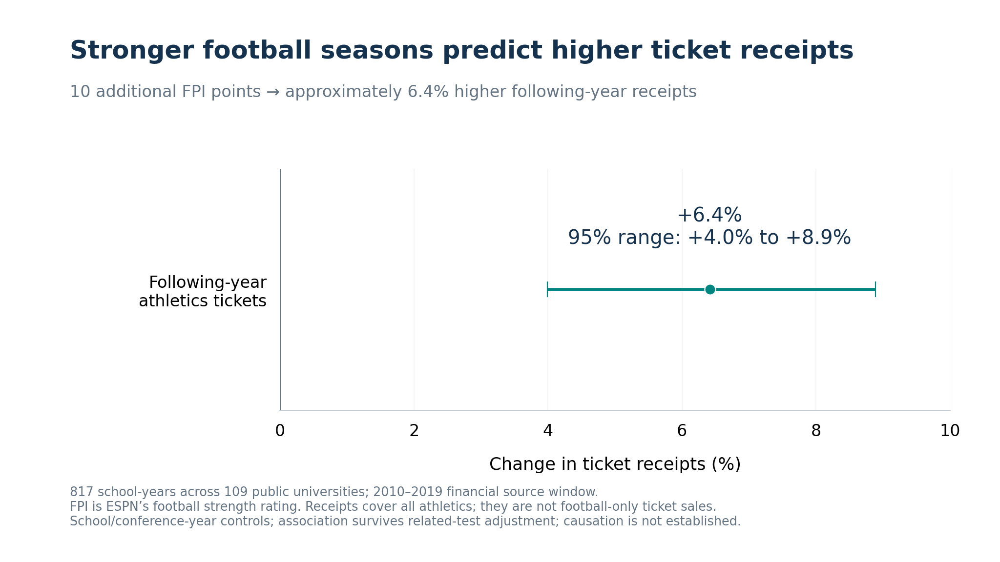
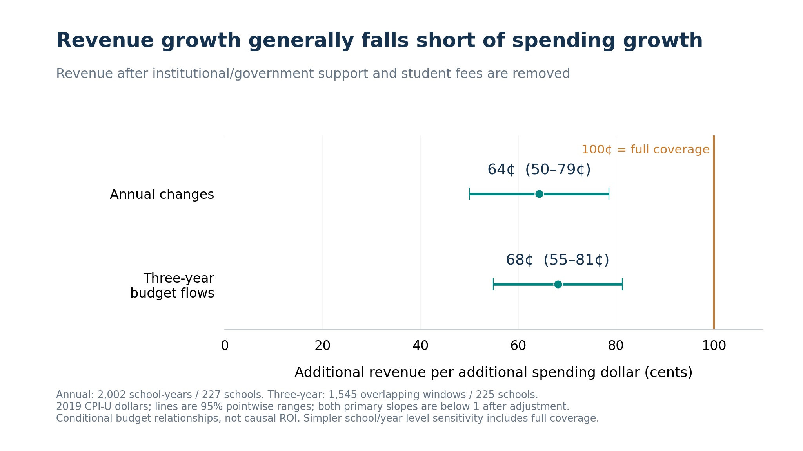
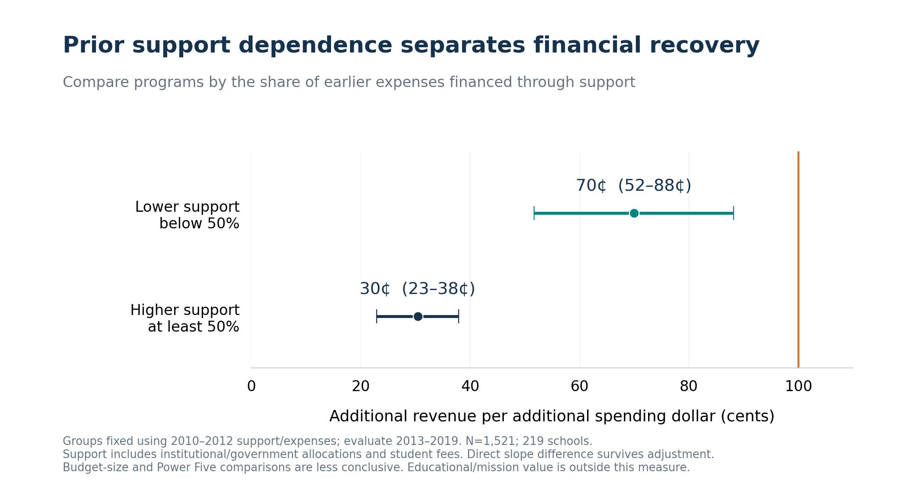
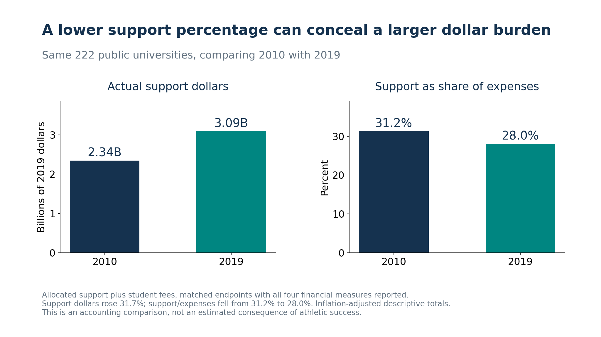

# Beyond the Scoreboard financial evidence for the audience

**Main conclusion:** Stronger football is linked to higher ticket receipts, but revenue growth falls short of spending growth in our main models. Prior support dependence separates programs with stronger and weaker recovery.

The main story uses existing supported findings. The complete research record remains in the technical appendices; no new models were estimated or selected by rerunning until significant.

## 1 The financial problem

GAO reports that 94% of Division I athletics departments spent more than they generated through athletics in 2023–2024. This external hook concerns whole departments, not football alone, and differs from our historical period. A gap before institutional support is not the same as a deficit after that support. [GAO source](https://www.gao.gov/products/gao-26-108640).

## 2 Stronger football is linked to higher ticket receipts

A ten-point increase in ESPN FPI is associated with **6.41% higher following-year all-athletics ticket receipts**, with a 95% interval of **3.99%–8.89%**. The model uses 817 school-years and 109 universities and survives its recorded related-test adjustment. FPI is a strength rating, not wins; the outcome is receipts rather than attendance. Prices, capacity and strategy may also matter. This is a conditional association, not an effect of an extra spending dollar.

## 3 Revenue growth does not fully match spending growth in the main models

In whole athletics-department budgets, annual changes associate each additional expense dollar with **$0.64 of additional revenue after allocated support and student fees are removed**. The 95% interval is **$0.50–$0.79**, using 2,002 school-years/227 schools. The full-coverage null is slope equals one, p=1.55898e-06; this remains below one after the recorded correction. The three-year cumulative-flow estimate is **$0.68**, interval **$0.55–$0.81**, and supports the same main comparison.

Revenue can finance spending, and accounting definitions and omitted decisions affect both. These slopes are not a causal return, an immediate 36-cent university bill or the payoff from a one-time cash investment. Exported revenue already nets some transfers, and gifts can be restricted or in-kind.

**Important sensitivity:** the simpler school/year levels estimate is **0.93 [0.82, 1.04]**, which includes full coverage. Our conclusion concerns the main change specifications; it is not universal across every model.

## 4 Funding dependence separates financial recovery

Programs with lower prior support dependence show approximately **$0.70** revenue growth per spending dollar, versus **$0.30** for programs whose allocations and student fees covered at least half of baseline expenses. The groups are fixed using 2010–2012, then evaluated later. The direct difference is **-0.395 [-0.588, -0.203]**; family-adjusted p=0.000214, all-fourteen adjusted p=0.000855, N=1,521/219 schools. This is a funding-model comparison, not proof that a particular school can cause a larger payoff.

## 5 Percentages can conceal the actual funding commitment

For the same 222 universities, real support dollars rose **31.7%**, from about **$2.34 billion to $3.09 billion**, while support as a share of expenses fell from **31.2% to 28.0%**. Expenses grew enough to shrink the share despite more actual funding. This is an observed matched-school accounting comparison, **not another regression correlation or an estimated consequence of winning**. It matters because a CFO must fund dollars, not percentages.

## 6 The audience takeaway

Stronger football and higher ticket receipts can coexist with incomplete cost recovery. A CFO should document expected incremental receipts, compare the program with similar funding models, and make the continuing university support commitment explicit. The study does not identify a comprehensive positive or negative university-wide financial return, nor a current NIL-era forecast.

## Brief disclosure and technical appendices

We also tested spending-to-success, recruitment and smaller-program breakthrough pathways. Those comparisons did not supply consistent primary evidence for their proposed advantages, so they are not the main presentation. Qualitative hype, pride and reputation were not measured. Omitting them from the main talk does not establish they are absent or have no value.

Historical donations are **supporting evidence only**: the reproduced STE estimate is +$191,243 per extra football win, but ten-outcome Holm p=0.0412 becomes 0.0742 across twenty coefficient tests. The broader correction does not clear 5%; IV replication remains partial. Do not treat this as equally robust evidence, add it to the ticket coefficient, or call it a spending return.

Full results and contrary evidence: [CFO technical report](CFO_RETURN_REPORT.md), [all primary feasibility results](FEASIBILITY_REPORT.md), [Anderson replication](ANDERSON_REPLICATION_REPORT.md), and [source provenance](docs/sources.md). All analysis and charts remain Python.
