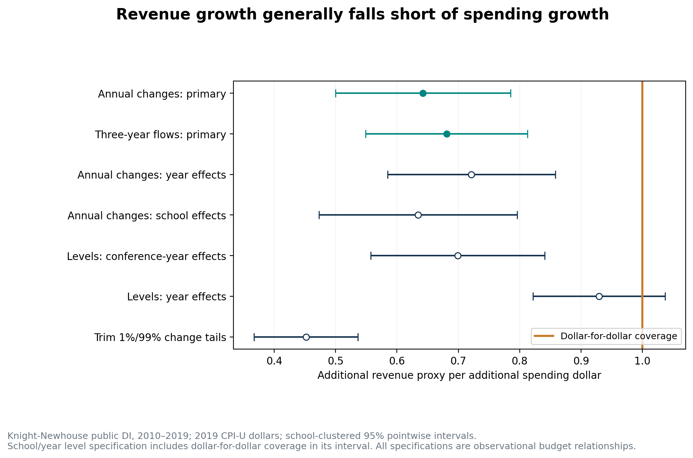
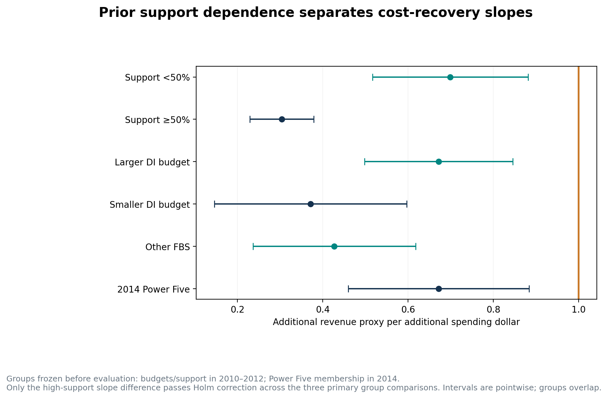
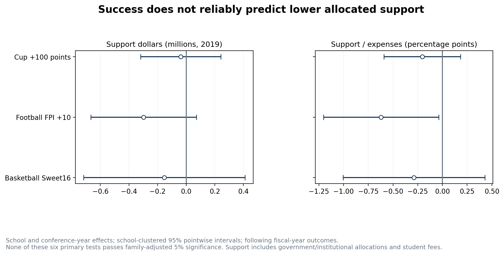
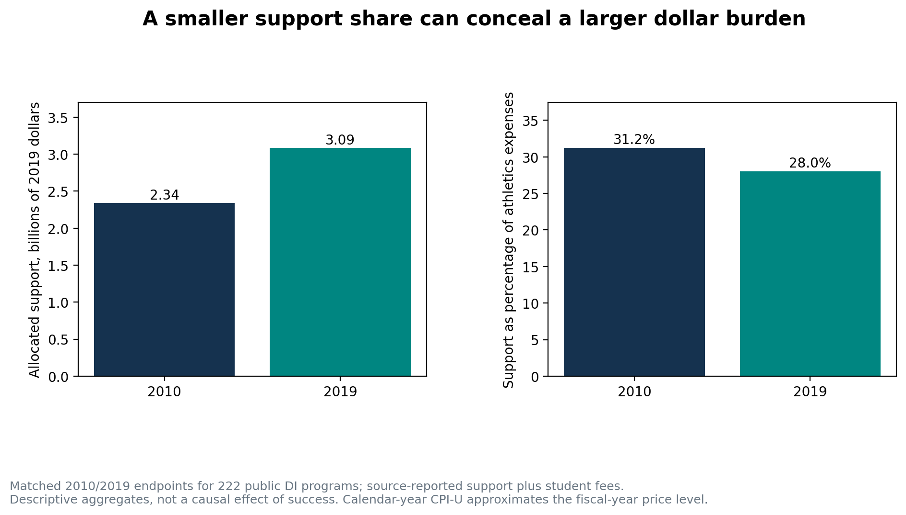
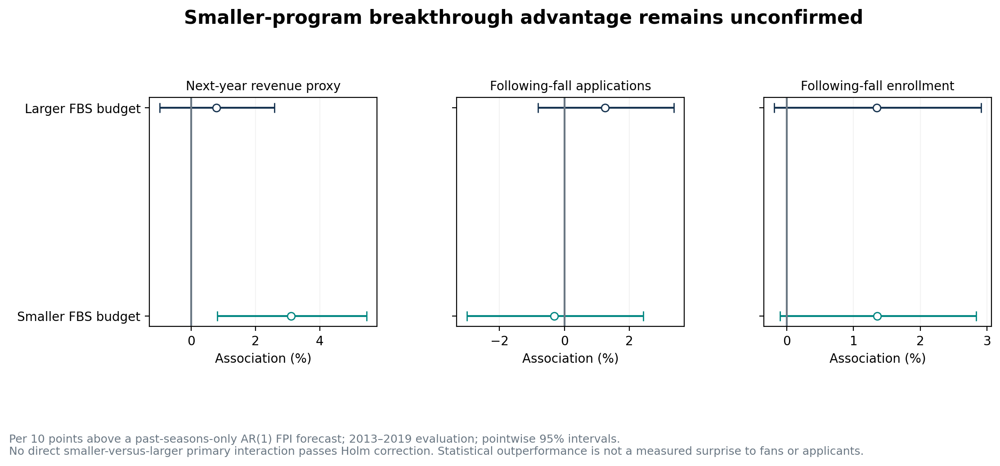

# Beyond the Scoreboard — cost recovery and who benefits

AC 547 Track A · Python-only · Historical 2010–2019 extension

## Presentation decision

**Winning has value; returns to additional spending require separate evidence.** Visibility, pride and engagement are potential campus benefits we did not directly measure. Football performance predicts ticket receipts in our panel, and a separate historical replication supplies qualified evidence of athletic alumni donations. These benefits do not establish that more spending pays for itself or creates a positive university-wide financial return. [The synthesis report](PROJECT_REPORT.md) presents this framing; the technical comparisons and all contrary findings remain below.

Annual real-dollar changes imply **0.64 dollars of additional revenue proxy per additional spending dollar** (95% interval 0.50–0.79; N=2,002, 227 schools). The three-year cumulative budget-flow slope is **0.68** (0.55–0.81; N=1,545, 225 schools). Both slopes are below one after adjustment across all fourteen primary extension tests.

These are conditional associations between reported budgets. They do not estimate what would happen if a CFO randomly increased spending. Revenue can fund spending, reporting rules can link the measures, and omitted pricing, facilities and institutional strategy can affect both. No causal ROI, profit-maximizing budget, or guaranteed future payoff is identified.

**Scope:** the original feasibility report remains intact. This extension tests cost recovery, school differences, support dependence and statistical football outperformance using the same audited source window. Every planned primary comparison and all sensitivity statuses are retained; favorable and unfavorable results appear together.

## Data, definitions and the recorded plan

The registered Knight-Newhouse export has 2,400 listed school-years for 240 institutions in 2010–2019. The prior public-DI eligibility and institutional-merger exclusions are retained. All original values remain unchanged; no missing financial observation, Cup score or institutional outcome is invented. Raw finances, joined panels, exact model cases and finance-based school classifications remain in ignored `data/private/`.

**R = exported total revenues − institutional/government support − student fees. E = exported total expenses. S = institutional/government support + student fees.** R is a net nonallocated-revenue proxy: total revenues already net transfers to the institution, and expenses may include excess transfers. Gifts can be restricted/in-kind. E−R is an accounting gap proxy; S is observed allocated support. They differ by E−total revenues. Neither is a verified cash deficit or audited economic profit.

All new dollar comparisons use published BLS CPI-U annual averages (series CUUR0000SA0), independently checked against all twelve months per year, in 2019 dollars. Calendar-year CPI approximates fiscal-year prices and does not measure athletics-specific cost inflation. Zero support and decreases are retained.

`config/return_plan.json` was committed at **a45a7a6** before extension estimation; the earlier feasibility results were already known. There are **14 primary null tests** in families of 2 cost-recovery, 3 school-type, 6 self-support and 3 smaller-program-outperformance comparisons. This is exploratory project development, not an independent externally preregistered replication. After the first estimates, joint budget/support interactions, shared-case dollar outperformance bridges and influence checks of negative AP results were added as disclosed secondary follow-ups.

Baseline groups require three observed years, 2010–2012. The all-DI budget median is **21.60 million** and the FBS-specific median is **54.92 million**, in 2019 dollars. Group outcomes begin in 2013. Support dependence is fixed at baseline S/E ≥50%; Power Five membership is frozen in 2014 for evaluation in 2015–2019, excluding independents. Smaller athletics budgets and smaller enrollment are separate definitions.

All **95 specifications** ran; **95 estimated**, 0 not estimable. Status, exclusions, controls, fixed effects, school counts, exact years, pointwise 95% intervals, raw and adjusted p-values are in `results/return_*.csv`. Numerical/source validation: **passed**. Four annual flows must be observed for the three-year comparisons; late anchors are lost to future outcomes. No post-2019 outcome is supplied.

## 1. Does additional revenue cover additional spending?

Primary annual model: ΔR_t = βΔE_t + enrollment-growth control + conference-by-year indicators + error. Differences use exact prior calendar years and include spending decreases. The test is **H0: β=1**, not H0: β=0. Errors cluster by school with cluster-count-minus-one t inference. Time cells with one case are excluded.

Primary three-year model: [R_t+R_(t+1)+R_(t+2)−3R_(t−1)] is regressed on the identical expression for E, with the end-to-pre enrollment log change and conference-by-year indicators. Every component is observed for an eligible program; incomplete windows remain missing. Windows overlap, so school clustering is essential. This compares accumulated budget flows relative to the preceding annual budget; it is not a return on a one-time investment. A fixed 3% real discount sensitivity discounts both revenue and expense flows.

| Specification | Revenue / spending dollar | 95% interval | Raw p: slope = 1 | N / schools |
| --- | --- | --- | --- | --- |
| Annual changes (primary) | 0.642 | [0.500, 0.785] | 1.56e-06 | 2,002 / 227 |
| Three-year cumulative (primary) | 0.681 | [0.549, 0.813] | 3.37e-06 | 1,545 / 225 |
| School/year levels | 0.929 | [0.821, 1.037] | 0.198 | 2,258 / 228 |
| School/conference-year levels | 0.699 | [0.557, 0.841] | 4.01e-05 | 2,232 / 227 |
| Changes with school effects | 0.634 | [0.473, 0.796] | 1.27e-05 | 2,002 / 227 |
| Changes, year effects | 0.721 | [0.584, 0.858] | 8.31e-05 | 2,026 / 228 |
| Three-year flows, 3% real discount | 0.681 | [0.549, 0.813] | 3.27e-06 | 1,545 / 225 |
| Three-year flows with school effects | 0.617 | [0.451, 0.783] | 8.89e-06 | 1,545 / 225 |
| Only positive spending changes | 0.623 | [0.495, 0.752] | 2.65e-08 | 1,459 / 225 |
| Exclude 1%/99% change tails | 0.452 | [0.367, 0.537] | 2.20e-28 | 1,935 / 227 |
| Exclude 2015–2017 | 0.625 | [0.474, 0.776] | 1.91e-06 | 1,334 / 227 |
| Ten-year financial reporters | 0.643 | [0.499, 0.787] | 1.87e-06 | 1,944 / 217 |
| Nominal-dollar sensitivity | 0.642 | [0.499, 0.784] | 1.36e-06 | 2,002 / 227 |

The primary annual coefficient corresponds to **64.2 cents of additional R and 35.8 cents of additional E−R gap per extra spending dollar**. The latter is an exact same-case coefficient identity. It does not imply the university immediately funds that entire gap: the same-case observed support slope is 0.111; changes in reported total balance account for the remainder.

**Material sensitivity:** the simpler school/year level model has a confidence interval that includes one. Conference-year effects remove common changes such as conference media distributions, while school/year effects retain those differences. Annual-change models remain below one with either time control. The primary recovery result is therefore robust across the stated change specifications, while a universal claim across every possible financial model would be too strong. Shared revenue/expense funding decisions and measurement error can bias the slopes.

Descriptively, **26.9% of 1,466 observed spending-increase years** had revenue growth at least as large as expense growth in the annual-model cases. The ratio of total associated revenue growth to total positive expense growth is 0.665, with a school-bootstrap interval [0.584, 0.747]. This selected positive-increase descriptive comparison is different from the all-change adjusted regression. It is not a probability that a new investment will pay off. Group coverage ratios, decreases and sample counts are fully reported in `return_observed_coverage.csv`.

The distributed-lag check includes current and previous spending changes together; its coefficients are reported in the full CSV. The previous change adds no detectable independent association in this window. It cannot resolve the longer-run return to facilities or recruit development.

## 2. Which types of schools appear to benefit most?

The table reports direct group interactions in annual-change models. Fixed baseline group indicators also allow different average growth. A higher slope means revenue growth more closely accompanies spending growth; it does not establish that the group has a positive net return or a larger causal payoff.

| Comparison | Reference group: slope [95% CI] | Comparison group: slope [95% CI] | Difference (second − first) | Raw difference p | Holm difference p | N / schools |
| --- | --- | --- | --- | --- | --- | --- |
| Baseline athletics budget | Larger: 0.672 [0.498, 0.846] | Smaller: 0.372 [0.146, 0.597] | -0.301 | 0.037 | 0.074 | 1,521 / 219 |
| Baseline support / expenses | Below 50%: 0.699 [0.517, 0.881] | At least 50%: 0.304 [0.229, 0.379] | -0.395 | 7.13e-05 | 2.14e-04 | 1,521 / 219 |
| 2014 FBS membership | Other FBS: 0.427 [0.236, 0.618] | Power Five: 0.672 [0.460, 0.884] | +0.245 | 0.096 | 0.096 | 498 / 100 |

**The clearest separator is prior support dependence.** The high-support slope is 0.304, versus 0.699 for less-dependent programs. The direct difference is -0.395 (95% interval [-0.588, -0.203]; raw p=7.13e-05, family-Holm p=2.14e-04, all-14-Holm p=8.55e-04). This is consistent with weaker commercial cost recovery in programs that historically relied more on allocations.

Smaller-budget programs also have a lower point estimate, but their direct difference does not clear family adjustment. The Power Five comparison points toward stronger recovery in Power Five schools, but the confidence interval for the direct difference includes zero. Neither is presented as a confirmed group advantage. Groups overlap and are not randomly assigned. In the secondary joint budget/support model, the high-support difference remains negative (-0.376, raw p=1.09e-04), while the budget interaction is uncertain (-0.059, p=0.567). These secondary results suggest support dependence is more informative than budget size alone in this panel; every coefficient is retained.

These comparisons can help a CFO choose a relevant reference group. They do not justify a school league table or extrapolation to private universities, which have different reporting coverage and can have different admissions responses. Participation, education, campus culture and other mission benefits are outside this financial measurement; incomplete commercial recovery does not establish that those benefits have no value.

## 6. Does success make athletics more self-supporting?

Success at ending-year t predicts actual allocated support S in fiscal t+1 and S/E as a percentage. Models absorb school and contemporaneous conference-by-year effects and control prior log enrollment. Football FPI belongs to season t−1; Cup and Sweet16 belong to the season ending t. Six primary exposure tests receive one family adjustment.

| Success measure | Next-year outcome | Association | 95% interval | Raw p | Holm p | N / schools |
| --- | --- | --- | --- | --- | --- | --- |
| Cup +100 points | Support, millions of 2019 dollars | -0.04 | [-0.32, +0.24] | 0.792 | 1.000 | 1,503 / 216 |
| Cup +100 points | Support / expenses, percentage points | -0.20 | [-0.59, +0.18] | 0.301 | 1.000 | 1,503 / 216 |
| Football FPI +10 | Support, millions of 2019 dollars | -0.30 | [-0.67, +0.07] | 0.113 | 0.563 | 813 / 109 |
| Football FPI +10 | Support / expenses, percentage points | -0.62 | [-1.20, -0.04] | 0.038 | 0.225 | 813 / 109 |
| Basketball Sweet16 | Support, millions of 2019 dollars | -0.15 | [-0.72, +0.41] | 0.594 | 1.000 | 1,786 / 227 |
| Basketball Sweet16 | Support / expenses, percentage points | -0.29 | [-1.01, +0.43] | 0.430 | 1.000 | 1,786 / 227 |

**None of the six tests survives the family-adjusted 5% threshold.** Football has a negative support-share point estimate with an unadjusted p-value below .05, but that evidence does not survive correction and actual support dollars remain uncertain. Tickets rising after football success, as in the earlier study, therefore does not establish that the institution reduces its contribution. Expenses, support and gap responses on identical cases, student-fee dollars per enrolled student and year-effect variants appear in the full output.

**An additional useful accounting finding:** among 222 programs with complete matched endpoints, real allocated support rose **31.7%** from 2010 to 2019, even as support fell from **31.2% to 28.0% of expenses**. A program can appear less dependent as a percentage while the dollar burden still grows. This is descriptive evidence about the panel, not an estimated consequence of winning.

The sum of E−R increased over these matched endpoints. A gap increase and an allocated-support increase should be reconciled, not equated: the reported total-revenue/expense balance also changed. `return_matched_endpoints.csv` contains the full four-measure bridge.

## 3. Does unexpected success benefit smaller programs more?

The main measure is FPI per ten points above an expanding AR(1) forecast trained only on previous seasons. Smaller-budget FBS programs are defined before evaluation using their 2010–2012 budgets. Models absorb school and conference-year effects and control prior FPI and prior enrollment. This controls earlier strength but cannot turn statistical outperformance into an exogenous surprise. Historical FPI was downloaded at the present vintage; revisions may mean it differs from information known at the time. Inference is conditional on the estimated forecast rule.

| Outcome | Larger-budget FBS: % [95% CI] | Smaller-budget FBS: % [95% CI] | Difference in log slopes | Raw difference p | Holm difference p | N / schools |
| --- | --- | --- | --- | --- | --- | --- |
| Next-year revenue proxy | +0.79% [-0.99, +2.59] | +3.11% [+0.81, +5.46] | +0.0228 | 0.056 | 0.169 | 571 / 98 |
| Following-fall applications | +1.26% [-0.82, +3.37] | -0.32% [-3.00, +2.44] | -0.0157 | 0.297 | 0.594 | 651 / 99 |
| Following-fall enrollment | +1.35% [-0.19, +2.91] | +1.36% [-0.10, +2.83] | +0.0001 | 0.994 | 0.994 | 681 / 100 |

**The hypothesized smaller-program advantage is not established.** Smaller-budget schools have a positive within-group revenue association, but the direct smaller-versus-larger revenue difference does not clear the raw 5% threshold or family adjustment. A significant subgroup slope alongside an insignificant other subgroup slope would not prove a difference. Applications and enrollment interactions are also inconclusive. Percentage changes do not imply equal dollar gains across different revenue bases.

Secondary comparisons use smaller enrollment, lower 2005–2008 historical FPI prominence, non-Power FBS membership, and preseason-unranked-to-final-AP-top20 breakthroughs. All outcomes and group differences are retained. The AP budget interaction for applications and enrollment is **negative**, rather than the proposed smaller-program advantage: log-slope differences -0.143 (raw p=0.002) and -0.095 (p=0.001). The smaller-program samples have 11 application-event rows across 10 schools and 12 enrollment-event rows across 11 schools. Events remain sparse and this is an exploratory, unadjusted family. These results are reported without implying that surprise wins cause lower demand.

A shared-case secondary bridge estimates following-year expense, revenue, gap and support dollar responses to outperformance for each budget group. These clarify why a positive percentage revenue response alone cannot establish that an unexpected strong season finances its associated costs.

## Robustness, inference and numerical validation

| model | omissions | min_coefficient | max_coefficient | max_null_p |
| --- | --- | --- | --- | --- |
| H_high_support | 219 | -0.4272087214381354 | -0.3308087405574627 | 0.0005186906106726 |
| R_annual | 227 | 0.5904508768769349 | 0.6649687666247635 | 1.6287791405116687e-05 |
| R_three_year | 225 | 0.6485365699887319 | 0.7214514997500299 | 1.4634640881287673e-05 |
| U_ap_small_budget_fbs_applications | 99 | -0.1726386087073115 | -0.1297500003186294 | 0.0044839959512351 |
| U_ap_small_budget_fbs_enrollment | 100 | -0.1133098920759838 | -0.0829001905776567 | 0.0025940118644971 |
| U_small_applications | 99 | -0.0207632040042395 | -0.0092611843922519 | 0.4942846268670594 |
| U_small_enrollment | 100 | -0.0044441330107125 | 0.002434648475053 | 0.999595003776158 |
| U_small_revenue | 98 | 0.0196394628077696 | 0.0260356848119149 | 0.1032812449207737 |

The influence table omits one program at a time; null p refers to slope=1 for recovery and interaction=0 otherwise. Omission identities and individual source amounts are not published. Cost-recovery estimates remain below one throughout these omissions; AP interactions remain negative. This is a robustness check, not independent replication. The AP/high-support influence rows are secondary diagnostics added after viewing the first extension estimates.

Independent full-rank dummy-variable OLS checks cover annual recovery, cumulative recovery, high-support interaction, FPI/support and the smaller-budget outperformance/revenue model. Source-cell preservation, exact-year CPI and accounting identities are checked separately. The actual validation record is `data/provenance/return_validation.json`; stale coefficient hashes do not count as passed.

Fourteen primary tests use Holm adjustments within their recorded families and across all fourteen; all pointwise intervals and raw p-values remain visible. The secondary specifications are exploratory and unadjusted, including AP negative interactions. The complete primary table follows; cost-recovery test p-values refer to β=1. Primary results from the earlier feasibility study are a separate previously examined family, not pooled into these extension corrections.

| model | family | coefficient | ci_low | ci_high | primary_null | test_p | holm_family_p | holm_all_primary_p | n | schools |
| --- | --- | --- | --- | --- | --- | --- | --- | --- | --- | --- |
| R_annual | cost_recovery | 0.6424442441948807 | 0.4996589195996228 | 0.7852295687901385 | 1.0 | 1.5589814093479046e-06 | 3.1179628186958093e-06 | 2.1825739730870663e-05 | 2002 | 227 |
| R_three_year | cost_recovery | 0.6808601538431387 | 0.5489202332486885 | 0.8128000744375888 | 1.0 | 3.371702116285438e-06 | 3.371702116285438e-06 | 4.383212751171069e-05 | 1545 | 225 |
| H_small_budget_all | school_types | -0.3005204016448507 | -0.5828482350124609 | -0.0181925682772406 | 0.0 | 0.037065360909977 | 0.074130721819954 | 0.4077189700097473 | 1521 | 219 |
| H_high_support | school_types | -0.3952291594996107 | -0.58757960966851 | -0.2028787093307114 | 0.0 | 7.128687487754456e-05 | 0.0002138606246326 | 0.0008554424985305 | 1521 | 219 |
| H_power_2014 | school_types | 0.2448420541993975 | -0.0445495674312843 | 0.5342336758300795 | 0.0 | 0.0963521969817466 | 0.0963521969817466 | 0.7708175758539728 | 498 | 100 |
| S_cup_support_m | self_support | -0.0375449425383581 | -0.3178885490528296 | 0.2427986639761133 | 0.0 | 0.7920531349670147 | 1.0 | 1.0 | 1503 | 216 |
| S_cup_support_pct_expense | self_support | -0.2040887138654544 | -0.5917311438456757 | 0.1835537161147668 | 0.0 | 0.3005581643030215 | 1.0 | 1.0 | 1503 | 216 |
| S_fpi_support_m | self_support | -0.2979022121500929 | -0.666950247666555 | 0.0711458233663692 | 0.0 | 0.1125096977541455 | 0.5625484887707278 | 0.787567884279019 | 813 | 109 |
| S_fpi_support_pct_expense | self_support | -0.6201409155552774 | -1.20380037509473 | -0.0364814560158248 | 0.0 | 0.0375155755472451 | 0.2250934532834707 | 0.4077189700097473 | 813 | 109 |
| S_sweet16_support_m | self_support | -0.1527676071404502 | -0.7173980145705859 | 0.4118628002896854 | 0.0 | 0.5944556580418275 | 1.0 | 1.0 | 1786 | 227 |
| S_sweet16_support_pct_expense | self_support | -0.2879098345937284 | -1.0055342110914374 | 0.4297145419039805 | 0.0 | 0.4300248073383455 | 1.0 | 1.0 | 1786 | 227 |
| U_small_revenue | small_school_breakthrough | 0.022770518728229 | -0.0006145984043099 | 0.046155635860768 | 0.0 | 0.0562072297185933 | 0.1686216891557801 | 0.5058650674673405 | 571 | 98 |
| U_small_applications | small_school_breakthrough | -0.0156716319239679 | -0.0453485114639426 | 0.0140052476160066 | 0.0 | 0.2972399657721817 | 0.5944799315443634 | 1.0 | 651 | 99 |
| U_small_enrollment | small_school_breakthrough | 6.86183890845742e-05 | -0.0185114747548865 | 0.0186487115330557 | 0.0 | 0.9941679500127876 | 0.9941679500127876 | 1.0 | 681 | 100 |

## What to present and what more data would improve

A defensible presentation has four findings: (1) stronger football performance predicts later ticket receipts in the earlier analysis; (2) in this extension, spending and revenue move together but primary adjusted cost-recovery slopes are below one; (3) historically support-dependent programs have weaker recovery; (4) success does not reliably predict lower actual support or a larger smaller-program admissions benefit. The matched-endpoint dollars-versus-share example makes the accounting implication concrete. A worthwhile research result does not require every step of the proposed pathway to be significant.

The existing four directions have enough value to present; there is no need to search the other four ideas merely to obtain a small p-value. The extra descriptive risk check finds different revenue-growth volatility across baseline-support groups, but that is a cross-program descriptive comparison and is not claimed as an insurance effect. Full risk counts are in `return_revenue_volatility.csv`.

**Best next acquisition:** additional Knight report fields for media/conference distributions, transfers, capital/debt and operating categories would help separate conference windfalls, transfers and expense composition. Earlier consistent pre-NIL years would improve baseline history, long lags and precision, provided corresponding public outcomes can be aligned. More years by themselves do not solve endogeneity. 2020–2021 COVID years and later NIL/revenue-sharing years belong in explicitly separate regime analyses; pooling them to increase N could obscure structural changes. No additional Knight login is required for the completed historical pass.

A university-specific causal investment case would additionally need project-level operating/capital cash flows, ticket price/capacity, gift restrictions, actual net tuition contribution, capacity and displacement, and an identification strategy. The current source supports an accounting risk/feasibility study. Student demand remains a possible benefit rather than a budget offset presumed to occur.

Reproduction: `python run_project.py --returns --download --test` uses the existing audited private feasibility panel and retrieves/validates CPI. `python -m scoreboard.validate_returns` reruns independent checks. `python run_project.py --returns --report-only` rebuilds this report and its five chart pairs from aggregate outputs without registered financial data. All analytic logic, models, tests and charts are Python. Human group commits, consultation and the final presentation remain assignment requirements.

## Primary sources and definitions

[Knight-Newhouse methodology](https://knightnewhousedata.org/about-the-data) defines financial years, transfers, allocations and reporting limitations. The registered workbook/report provenance remains in the original acquisition documents. [BLS public API](https://api.bls.gov/publicAPI/v2/timeseries/data/CUUR0000SA0?startyear=2010&endyear=2019&annualaverage=true) supplies the actual CPI values, with the [official historical CPI-U table](https://www.bls.gov/cpi/tables/supplemental-files/historical-cpi-u-202310.pdf) documenting the series. ESPN/NACDA/IPEDS URLs, source vintage and matching rules are retained in `docs/sources.md` and the feasibility manifests.

For external context, [GAO’s 2026 athletics-finance study](https://www.gao.gov/products/gao-26-108640) independently reports widespread gaps between generated revenue and expenses in NCAA data, including a 2014–2015 comparison. It uses a different sample, definitions and period; it does not validate our coefficients or supply missing observations. The earlier feasibility report compares the project with published Flutie Effect studies.

## Published research: winning benefits versus spending returns

A separate public-data [Anderson replication](ANDERSON_REPLICATION_REPORT.md) reproduces all ten estimates, standard errors and sample sizes from the study’s STE model in Python. Athletic alumni gifts increase with additional football wins in that historical model, while the applications estimate remains uncertain. The IV matching translation remains partial, with numerical differences disclosed. This does not overturn the later-period accounting findings or establish a causal spending return.

The presentation should say that published evidence supports some benefits from winning, while dependable recruitment payoffs and full cost recovery remain unestablished in our analysis. The zero-sum nature of wins on a fixed schedule is an economic interpretation, not an estimated explanation of our recovery slope. All athletics benefits need not be zero-sum. Do not add coefficients across different studies, periods or revenue definitions.
