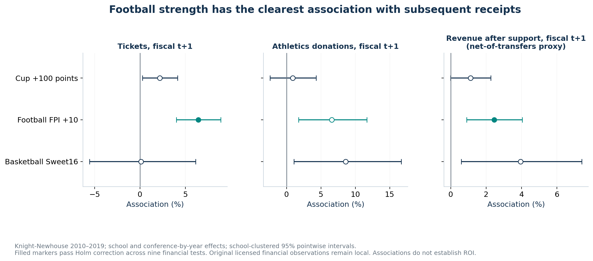
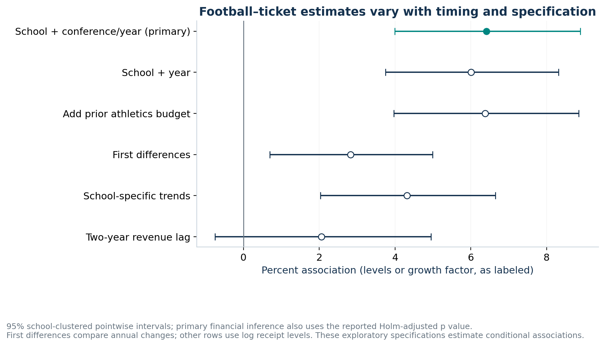
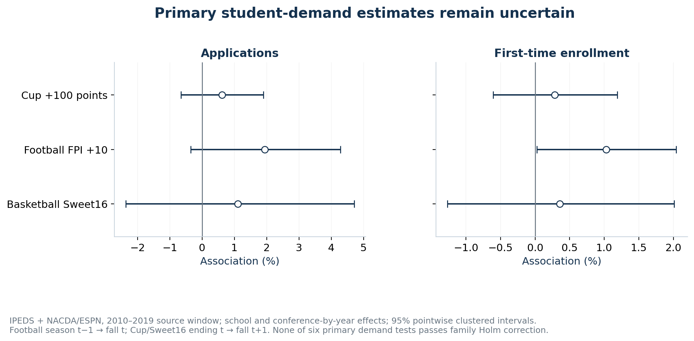
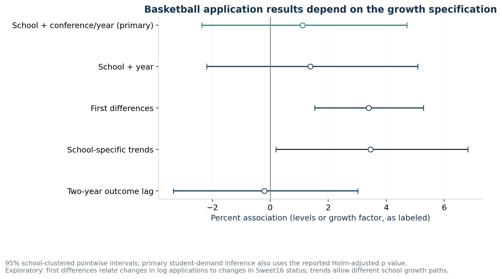
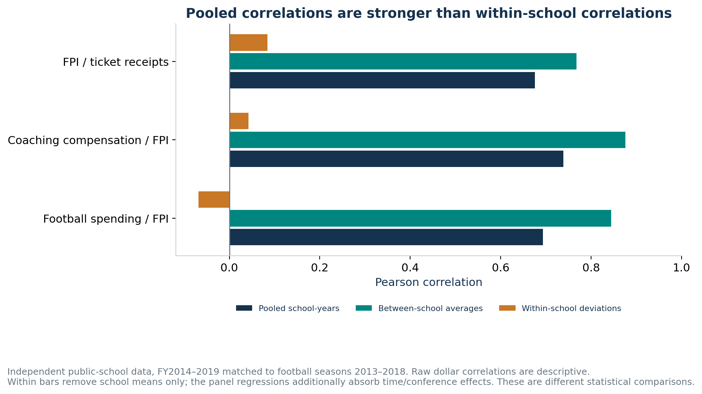
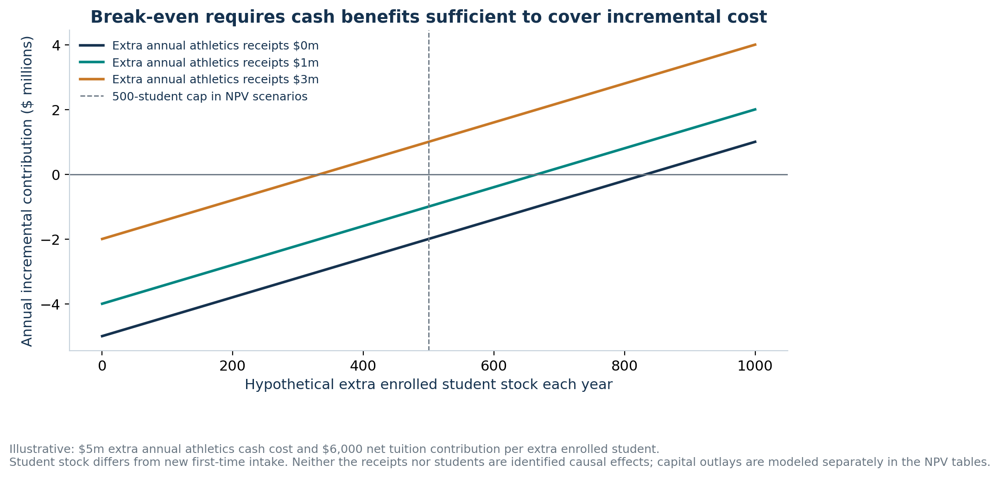

# Beyond the Scoreboard — expanded feasibility report

AC 547 Track A · Python-only analysis · Historical 2010–2019 source window

## Feasibility decision

**Proceed with the project as a conditional financial-return study.** The strongest validated relationship is football strength predicting subsequent athletics receipts. The available data do not establish that additional spending causes better performance or a positive university-wide return.

In the primary model, 10 more FPI points are associated with **6.41% higher next-year ticket receipts** (95% interval 3.99% to 8.89%; raw p=4.82e-07; financial-family Holm p=4.34e-06; N=817, 109 schools). Revenue after reported allocated support is associated with a **2.46% increase** (interval 0.90% to 4.04%; Holm p=0.017), subject to the transfer-definition qualification below.

None of the three primary spending-success tests or six primary student-demand tests passes the family-adjusted 5% threshold. Basketball nevertheless shows a positive applications association in first-difference and school-trend models. That is a useful, specification-sensitive finding to investigate—not a reason to claim either a universal Flutie Effect or no Flutie Effect.

The proposed spending → success → receipts/student demand → financial return chain remains a pathway to test. The regressions do not identify causal mediation and their coefficients must not be multiplied into an ROI estimate.

## Dataset and merge audit

The registered workbook contains 2,400 rows for 240 listed institutions. There are 2,289 rows with total revenue and expense data. Historical subdivision eligibility yields 2,322 Division I school-years; excluding three programs with consolidation/scope changes leaves 2,292 primary-eligible rows before model-specific missingness and lags. Missing financial observations and Cup scores remain missing.

All 2,400 source rows retain their original financial values and join to an IPEDS institution. The stable athletics-program key is distinct from the retained original source IDs. Kennesaw’s former ID 140164 maps to program 486840; the fall-2015 duplicate is resolved to the active consolidated IPEDS entity. Kennesaw, UTRGV, and Purdue Fort Wayne are excluded from primary models and included in a sensitivity analysis.

ESPN football season s maps to academic/fiscal ending year s+1; each FPI snapshot is verified to occur after the season in January/February. Fall IC conference collection t−1 maps to the season ending t, checked against Nebraska’s Big12-to-BigTen transition. IPEDS pre-2014 APPDATE cohort rules and reported/imputed flags use the original dictionaries.

Football student demand uses fall t following football season t−1. Cup/Sweet16 demand uses fall t+1 following the spring season ending t. Financial returns use fiscal t+1. Alternate-fall and extra-year lags are reported. No outcomes after 2019 are invented. Early and late source years are lost where a required lag/outcome is unavailable.

Sweet16 and main64 indicators come from exhaustive annual NACDA ledgers: exactly 16 and 64 matched schools each year. A negative event-membership indicator is derived only after that completeness check; it is not a fabricated zero Cup score. Final/opening AP polls are checked against their own year/type; opening polls require all ranked teams to have played zero games.

| Year | Listed schools | DI schools | Primary eligible | Expense reports | Cup matches | FPI schools |
| --- | --- | --- | --- | --- | --- | --- |
| 2010 | 240 | 230 | 227 | 226 | 196 | 103 |
| 2011 | 240 | 230 | 227 | 226 | 195 | 103 |
| 2012 | 240 | 231 | 228 | 228 | 193 | 103 |
| 2013 | 240 | 232 | 229 | 230 | 199 | 107 |
| 2014 | 240 | 233 | 230 | 229 | 197 | 109 |
| 2015 | 240 | 233 | 230 | 231 | 195 | 111 |
| 2016 | 240 | 233 | 230 | 229 | 202 | 111 |
| 2017 | 240 | 233 | 230 | 230 | 195 | 111 |
| 2018 | 240 | 233 | 230 | 230 | 191 | 113 |
| 2019 | 240 | 234 | 231 | 230 | 199 | 112 |

Validation: source-cell preservation, exact future-cohort joins, all 18 primary sample sizes, and three independent full-rank dummy-OLS comparisons passed. The saved coefficients, standard errors and p-values agree with the independent implementation. Audit details are in `data/provenance/feasibility_validation.json`; school-level licensed join/sample files remain local.

## Specifications and inference

The expanded plan was recorded before the new estimation in `config/feasibility_plan.json`. There are 18 primary exposure tests: three spending-success, nine success-finance, and six student-demand tests. Primary models absorb school and contemporaneous basketball-conference-by-year effects. This controls stable school differences and common annual conference conditions; lagged log total enrollment is included throughout. Spending models also control the lagged EADA sport participation-category count, a proxy for sponsored teams rather than an exact NCAA team count.

All uncertainty is clustered by school, with a Student t reference using schools minus one degrees of freedom; absorbed parameter rank enters the covariance correction. Singleton cells are removed recursively. Reported intervals are pointwise 95% intervals. Holm p-values adjust within the three primary families; the CSV also provides Holm adjustment across all 18. Secondary tests are exploratory and their displayed p-values are unadjusted.

All **189 primary/secondary specifications** executed; status and complete-case exclusions are recorded in `results/feasibility_model_status.csv` and `feasibility_sample_flow.csv`. Raw coefficients, controls, fixed effects, N, schools, years, intervals and p-values are in `feasibility_models.csv`. This is an internal research plan, not an externally registered protocol; the earlier EADA results were already known. Additional audit checks are fully reported and the primary grid was retained. Some specifications estimate different comparisons; a lower p-value does not make one the preferred causal model.

## 1. Athletic spending and competitive success

These are changes within the same program after the stated controls. Monetary predictors are logged; the table scales the result to 10% higher prior spending. Basketball uses EADA sport-specific expense because the registered Knight report does not provide that measure. Its binary Sweet16 outcome uses a linear probability model.

| Test | Association | 95% interval | Raw p | Holm p (family) | N / schools | Exposure years |
| --- | --- | --- | --- | --- | --- | --- |
| Prior total expense +10% → Cup | +4.64 Cup points | [-1.00, +10.27] Cup points | 0.106 | 0.212 | 1,674 / 216 | 2011–2019 |
| Prior football expense +10% → FPI | +0.45 FPI points | [-0.03, +0.94] FPI points | 0.064 | 0.192 | 890 / 106 | 2011–2019 |
| Prior basketball expense +10% → Sweet16 probability | +0.16 percentage points | [-0.74, +1.07] percentage points | 0.721 | 0.721 | 2,004 / 226 | 2011–2019 |

The positive point estimates are compatible with spending helping performance, but these primary intervals include zero. Strong pooled spending/performance correlations mostly compare programs with different established resources. They cannot show that increasing a particular program’s budget will generate the same improvement. Current-spending, Cup-rank/percentile, pre-2018 scoring, balanced-Cup and coaching-reporting checks are included in the complete results.

## 2. Competitive success and subsequent athletics finances

| Test | Association | 95% interval | Raw p | Holm p (family) | N / schools | Exposure years |
| --- | --- | --- | --- | --- | --- | --- |
| 100 additional Cup points → Ticket receipts | +2.17% | [+0.25, +4.13]% | 0.026 | 0.124 | 1,507 / 216 | 2011–2018 |
| 100 additional Cup points → Athletics donations | +0.87% | [-2.43, +4.28]% | 0.608 | 1.000 | 1,484 / 213 | 2011–2018 |
| 100 additional Cup points → Revenue after allocated support (proxy) | +1.12% | [-0.01, +2.26]% | 0.053 | 0.159 | 1,503 / 216 | 2011–2018 |
| 10 additional FPI points → Ticket receipts | +6.41% | [+3.99, +8.89]% | 4.82e-07 | 4.34e-06 | 817 / 109 | 2011–2018 |
| 10 additional FPI points → Athletics donations | +6.58% | [+1.73, +11.66]% | 0.008 | 0.054 | 813 / 109 | 2011–2018 |
| 10 additional FPI points → Revenue after allocated support (proxy) | +2.46% | [+0.90, +4.04]% | 0.002 | 0.017 | 813 / 109 | 2011–2018 |
| Sweet Sixteen appearance → Ticket receipts | +0.10% | [-5.58, +6.12]% | 0.973 | 1.000 | 1,790 / 227 | 2011–2018 |
| Sweet Sixteen appearance → Athletics donations | +8.59% | [+1.07, +16.68]% | 0.025 | 0.124 | 1,747 / 225 | 2011–2018 |
| Sweet Sixteen appearance → Revenue after allocated support (proxy) | +3.94% | [+0.60, +7.40]% | 0.021 | 0.124 | 1,786 / 227 | 2011–2018 |

Exploratory actual-win and visibility checks are below. Actual winning percentage also has a positive ticket association, so the financial pattern is not confined to the FPI definition. Coarser AP/breakthrough indicators are less conclusive. These p-values are unadjusted and the success units are different.

| Specification | Association | 95% interval | Raw p | N / schools |
| --- | --- | --- | --- | --- |
| Win percentage +10 points → tickets | +2.07% | [+1.13, +3.02]% | 2.91e-05 | 817 / 109 |
| Win percentage +10 points → revenue-after-support proxy | +0.70% | [+0.13, +1.28]% | 0.017 | 813 / 109 |
| Final AP top20 → tickets | +3.30% | [-0.32, +7.06]% | 0.074 | 817 / 109 |
| Opening-unranked → final top20 → tickets | +0.82% | [-3.56, +5.41]% | 0.715 | 817 / 109 |

Football’s ticket and revenue-after-support associations pass both within-financial-family Holm correction and the all-18-primary correction. Its donor association is positive at the raw 5% level but does not pass the nine-test financial-family correction. Cup/ticket and Sweet16/donation or revenue-proxy associations also fail that family correction. A small raw p-value is not labeled confirmatory evidence when its adjusted test does not pass.

The success measures have different units and samples. A smaller p-value for football does not by itself establish a statistically larger effect than basketball/Cup success or a superior return per dollar spent. The common-sample models address sample comparability; causal cost-effectiveness remains unidentified.

The receipt components are all-sports ticket receipts and athletics-designated donations, not football-only ticket receipts or all university philanthropy. Donations can contain restricted or in-kind support. Revenue after support is **exported total revenues minus the separate institutional/government-support and student-fee fields**. Total revenue already nets transfers to the institution; source expense definitions can include excess transfers. This is a qualified accounting proxy, not gross externally generated revenue, cash operating profit, or the university’s economic return. The [Knight methodology](https://knightnewhousedata.org/about-the-data) explains the reporting categories.

The next-year football/ticket result remains positive after prior-budget controls, first differencing and school-specific trends. At a two-year financial lag, the estimate is 2.06% (interval -0.75% to 4.95%; raw p=0.151), which includes zero. The annual association must not be projected automatically into a permanent revenue gain.

## 3. The Flutie Effect: applications and first-time enrollment

| Test | Association | 95% interval | Raw p | Holm p (family) | N / schools | Exposure years |
| --- | --- | --- | --- | --- | --- | --- |
| 100 additional Cup points → applications | +0.61% | [-0.66, +1.90]% | 0.345 | 1.000 | 1,431 / 214 | 2011–2018 |
| 100 additional Cup points → first time enrollment | +0.29% | [-0.61, +1.19]% | 0.531 | 1.000 | 1,532 / 218 | 2011–2018 |
| 10 additional FPI points → applications | +1.94% | [-0.35, +4.28]% | 0.096 | 0.481 | 908 / 112 | 2011–2019 |
| 10 additional FPI points → first time enrollment | +1.03% | [+0.03, +2.04]% | 0.044 | 0.267 | 948 / 112 | 2011–2019 |
| Sweet Sixteen appearance → applications | +1.11% | [-2.37, +4.71]% | 0.535 | 1.000 | 1,694 / 225 | 2011–2018 |
| Sweet Sixteen appearance → first time enrollment | +0.36% | [-1.27, +2.01]% | 0.667 | 1.000 | 1,816 / 229 | 2011–2018 |

No primary demand measure clears the six-test Holm correction. Football’s first-time-enrollment coefficient has a raw p just below .05 but not an adjusted p below .05. Cup estimates are comparatively small; FPI/application and Sweet16/application intervals still admit meaningful positive or negative associations. Failure to reject zero does not prove no effect or identify whether measurement, capacity, omitted changes, or limited identifying variation explains the result.

| Specification | Association | 95% interval | Raw p | N / schools |
| --- | --- | --- | --- | --- |
| Sweet16, primary level model | +1.11% | [-2.37, +4.71]% | 0.535 | 1,694 / 225 |
| Sweet16, annual changes | +3.39% | [+1.53, +5.29]% | 3.60e-04 | 1,411 / 226 |
| Sweet16, school-specific trends | +3.46% | [+0.20, +6.82]% | 0.038 | 1,713 / 226 |
| Sweet16, two-year outcome lag | -0.21% | [-3.34, +3.03]% | 0.897 | 1,480 / 225 |
| Final AP top20, following fall | +1.56% | [-1.82, +5.07]% | 0.367 | 908 / 112 |
| Opening-unranked → final AP top20 | -0.44% | [-3.94, +3.18]% | 0.806 | 908 / 112 |
| Main64 basketball appearance | +0.11% | [-2.25, +2.52]% | 0.930 | 1,694 / 225 |

The Sweet16 annual-change coefficient is approximately .0334 log points (about 3.4% in the application-growth factor), while allowing school-specific trends gives roughly 3.5% higher application levels. Both are exploratory, unadjusted findings. The primary level model and extra-year model remain inconclusive. These results suggest that growth assumptions matter; they do not justify selecting the favorable model as proof. AP top20, preseason-unranked breakthroughs, main64 participation, football win percentage and other lags are all reported, including their insignificant results.

The following diagnostic holds the school-year cases fixed to separate sample composition from the growth/control choices. Differences are calculated on the full calendar panel before applying the common-case restriction. The table varies level versus annual-change outcomes, conference/year versus year controls, and school-specific trends; it does not replace the primary model.

| Specification | Association | 95% interval | Raw p | N / schools |
| --- | --- | --- | --- | --- |
| Same cases: levels, school + conference/year | +1.26% | [-2.62, +5.29]% | 0.529 | 1,393 / 225 |
| Same cases: levels, school + year | +1.00% | [-2.89, +5.06]% | 0.617 | 1,393 / 225 |
| Same cases: annual changes, year | +3.40% | [+1.51, +5.33]% | 4.33e-04 | 1,393 / 225 |
| Same cases: annual changes, conference/year | +3.14% | [+1.24, +5.07]% | 0.001 | 1,393 / 225 |
| Same cases: levels, school-specific trends | +3.31% | [-0.38, +7.14]% | 0.079 | 1,393 / 225 |

On these identical cases, the annual-change estimate remains positive with conference/year controls. Level models remain inconclusive, and the school-trend interval now includes zero. Thus sample composition alone does not explain the change-model signal, but the favorable trend result is not stable across the two samples. No one model is promoted after seeing its significance.

Same-sample aggregate-only, football-only, basketball-only and joint comparisons use identical FBS school-years and the same subsequent fall. A joint coefficient holds total Cup performance—including the high-profile sports—fixed, so it is a conditional composition comparison, not the sport’s total effect. These comparisons are in the `common_` models.

## Independent audit of the earlier football pilot

| Relationship | Earlier claim | Independent pooled r | Between-school r | Within-school r | Pooled N / schools |
| --- | --- | --- | --- | --- | --- |
| Football expense / FPI | 0.556 | 0.694 | 0.844 | -0.068 | 649 / 111 |
| Coaching compensation / FPI | 0.646 | 0.739 | 0.876 | 0.042 | 648 / 111 |
| FPI / ticket receipts | 0.479 | 0.676 | 0.768 | 0.085 | 650 / 111 |

The independently assembled FY2014–2019 data show positive pooled correlations in the same directions, with different magnitudes and about 111 schools rather than the unknown original 52. The school/year-only following-year ticket model gives **6.14% per 10 FPI points** (interval 3.43% to 8.92%, p=1.30e-05, N=539, 110 schools), compared with the earlier conversational claim of 3.2%. Its usable fiscal exposure years are 2014–2018 because next-year receipts must exist.

This independently supports the directional football/receipt relationship. **It does not reproduce the original numerical pilot.** Its 52-school membership, raw data, precise period alignment and complete specification were not supplied. Our coaching field measures total compensation for all football coaches; the original field definition is unavailable. No schools were selected to match its coefficients. FY2014–2019 aligns to football seasons 2013–2018; a season-2014-onward subset and an explicitly incorrect same-printed-label timing diagnostic are retained in `pilot_models.csv` and `pilot_correlations.csv`. The aligned 2019 football season would require FY2020 financial data, outside the historical export.

## Sensitivity, influence and subgroup limits

The full specification grid includes school/year effects, conference/year effects, prior-budget controls, first differences, school trends, extra-year lags, positive-log versus inverse-hyperbolic-sine financial outcomes, reported-only IPEDS values, merger inclusion, expense-tail trimming, scoring-period restrictions and balanced Cup coverage. None is selected as the headline because of its p-value.

| model | omissions | coefficient_min | coefficient_max | largest_raw_p |
| --- | --- | --- | --- | --- |
| B_fpi_net_nonallocated_revenue_proxy | 109 | 0.0218 | 0.0274 | 0.005 |
| B_fpi_ticket_sales | 109 | 0.0572 | 0.0649 | 1.43e-06 |
| C_cup_applications | 214 | 0.0044 | 0.0076 | 0.464 |
| C_fpi_applications | 112 | 0.0104 | 0.0220 | 0.245 |
| C_sweet16_applications | 225 | 0.0022 | 0.0197 | 0.892 |
| C_sweet16_applications_first_differences | 226 | 0.0304 | 0.0381 | 0.001 |

The omission table reports raw log-scale coefficients: each school is omitted once, with remaining singleton cells removed again. The football ticket and revenue-proxy coefficients remain positive and raw-significant throughout; the Sweet16 annual-change signal also survives each omission. This is an influence diagnostic, not independent replication or a multiplicity-adjusted causal test.

Historical Power Five versus other-FBS differences are tested directly using interaction terms on the 2015–2019 sample, excluding independents. The broad FPI/application and revenue-proxy interaction tests do not establish different returns by group. Some Sweet16 subgroup interactions have small raw p-values, but the smaller-program cell below has only one success school/event. Those estimates cannot support a general recommendation for smaller universities.

| group | n | schools | event_rows | event_schools | switching_schools |
| --- | --- | --- | --- | --- | --- |
| all | 417 | 105 | 44 | 27 | 27 |
| power_five | 212 | 53 | 43 | 26 | 26 |
| other_fbs | 205 | 52 | 1 | 1 | 1 |

Historical prominence is based only on 2005–2008 FPI. Expanding-window AR(1) forecasts use past seasons only, but the historical rating vintage was retrieved in 2026; these are not real-time forecast vintages. Their residuals measure statistical outperformance, not known student expectations. A separate opening-unranked-to-final-top20 indicator uses actual AP poll ledgers. Results and interaction intervals are reported in the `outperformance_` and `breakthrough_prominence_` models. Sparse events and exploratory testing limit subgroup conclusions.

## Comparison with published Flutie Effect research

[Pope and Pope (2009), Southern Economic Journal](https://devingpope.com/assets/files/Website_SEJ%20Sports.pdf) studied roughly 330 Division I schools over 1983–2002. They reported application increases around 2–8% for top-20 football and top-16 basketball success, with larger responses at private schools. Their broader population, earlier period and outcome definitions differ from this public-school financial sample. Their findings motivate the visibility measures; they do not guarantee the same result here.

[McFarland, Groothuis and Guignet (2024), Contemporary Economic Policy](https://onlinelibrary.wiley.com/doi/full/10.1111/coep.12642) used 121 FBS institutions, football 2014–2018 and applications 2015–2019. They estimated roughly 2.1% more Group-of-Five applications per 10 percentage points of winning percentage. Their Table 2 marks that total-applications result at the **10% significance level, not 5%**. Their specification reports year effects and institutional/state controls; ours also absorbs school effects and uses different controls/sample.

Our public-school, conference/year-controlled comparison gives **0.32%** for other FBS schools per 10 winning-percentage points (interval -0.68% to 1.34%; raw p=0.525; N=524, 106 schools). The group-difference test is also inconclusive. This is a comparison of research questions, not a reproduction or refutation of the published model. Its private-school coverage and faculty-pay, state-income and high-school-graduate controls are not duplicated.

## CFO interpretation and cautious financial scenarios

The evidence supports treating football success as relevant to an athletics receipt forecast, conditional on the model. It does not give the CFO an identified spending-to-success conversion, attributable enrollment response, or causal return on a proposed investment. Funding should not be justified by multiplying pooled correlations, adding applicants as tuition-paying students, or counting athletics donations twice.

| Hypothetical extra annual receipts | Extra enrolled student stock to break even |
| --- | --- |
| $0 | 834 |
| $1,000,000 | 667 |
| $3,000,000 | 334 |

With a 500-student capacity limit and $6,000 contribution per student, the student channel supplies at most $3m annually. The zero- and $1m-receipt cases in this $5m-cost example therefore cannot break even within that capacity; the unconstrained student requirements exceed 500.

The separate ten-year cohort scenarios distinguish **planned new first-time intake** from the extra enrolled stock: four study years, explicit retention and a 500-student capacity limit determine how many additional students are actually in attendance. As one purely hypothetical example, 100 planned extra entrants annually, 90% retention, $6,000 net tuition contribution, $1m extra annual athletics receipts and $5m extra annual athletics cash cost yield a ten-year NPV of **-$16.82m** at a 6% rate with no initial capital outlay. This is scenario arithmetic, not an empirical estimate of an athletics-induced enrollment increase.

The tables vary receipts, student intake, retention, discount rates and initial capital outlay. Capacity limits can reduce admitted extra intake. Tuition contribution is after aid/discounts and incremental student-service cost; annual athletics cash cost excludes the separately modeled initial capital expenditure. Constant-dollar flows require a consistent real discount rate. Persistence of demand, displaced students, restrictions on gifts, opportunity costs and program-specific financing would need institution-level review. See `cfo_break_even_scenarios.csv` and `cfo_npv_scenarios.csv`.

## Deliverables, reproduction and actual remaining limits

The Python implementation, public source URLs, hashes, data dictionaries, period/ID rules, model outputs, exclusion counts, six new PNG/SVG figure pairs and this report are available in the project repository. Expanded descriptive statistics, annual nominal financial summaries and aggregate EADA/Knight reconciliation are in `feasibility_descriptive_statistics.csv`, `feasibility_annual_financial_summary.csv` and `source_reconciliation_summary.csv`. Large source changes are flagged for review, without automatic deletion or treating a genuine demand jump as an error. The registered workbook and school-level finances remain local under `data/private/`; no access credentials or registrations are fabricated or committed.

Full local study: `python -m scoreboard.performance --download`, stage the registered workbook as documented, then `python -m scoreboard.feasibility --build`. Independent verification: `python -m scoreboard.validate_feasibility`. Report-only reproduction from saved aggregate results: `python -m scoreboard.feasibility --report-only`. The earlier EADA-only results remain a separate starter analysis, not the preferred financial evidence.

**Remaining research limits:** exact original 52-school replication requires its missing sample/specification; the transfer-netted financial proxy cannot establish gross cash profit; real sponsored-team counts are proxied; private-school generalizability is limited; only observed Cup scorers enter Cup models; some applications precede final postseason information; reporting changes, admissions marketing/platform changes, pricing/capacity and reverse causality remain possible. More observations cannot by themselves solve causal identification.

**Remaining assignment actions:** the group must review the feasibility conclusions, confirm the assignment PDF revision, obtain topic approval, arrange instructor consultation, invite the four other members/instructor to the shared repository, contribute their own substantive commits, and produce/rehearse final slides. This report is a completed feasibility analysis, not a claim that those human collaboration and submission requirements are complete.
