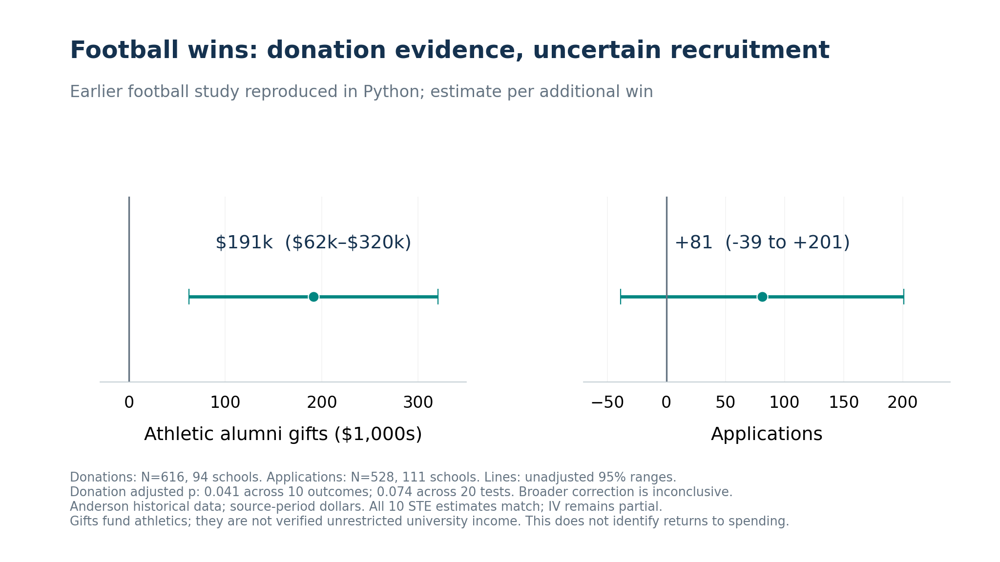
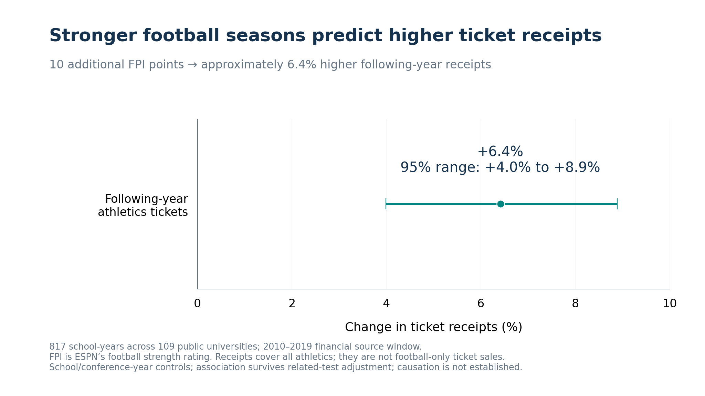
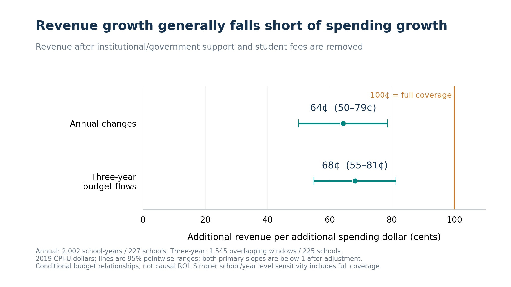

# Beyond the Scoreboard: winning, spending and university value

AC 547 · Track A · Python analytics · Evidence synthesis · November 11, 2026

## The question and the conclusion

**Winning has value. Whether additional athletics spending pays for itself is a separate question.** A winning season may bring visibility, pride, recognition and engagement. We did not directly measure those benefits. We found measurable associations with athletics receipts, while recruitment gains and a positive university-wide financial return remain unestablished in our analysis.

The project asks: **Does the financial return associated with athletic investment depend on the type of success and the university’s funding model?** We examine spending, competitive performance, receipts, applications, enrollment and support separately. The proposed spending → success → benefits → return pathway is not a proven causal chain. A win’s benefits do not establish that a university can reliably purchase enough additional wins to cover its spending.

## Separate potential benefits from measured outcomes

| Benefit or financial question | What the evidence shows | Interpretation |
| --- | --- | --- |
| Visibility, pride, reputation and engagement | Plausible campus benefits; no direct measurement or valuation in this project | Potential value, not a tested result or assumed financial offset |
| Athletic alumni operating donations | STE replication: +$191,243 per extra football win; 95% interval $62,114–$320,373 | Historical source dollars; gift outcome is athletics-specific; correction-dependent evidence |
| Following-year athletics ticket receipts | +6.41% per +10 FPI; 95% interval +3.99% to +8.89% | Later-period observational association; survives related-test adjustment |
| Applications and first-time enrollment | No primary later-period comparison survives its six-test adjustment | Uncertain under these models; absence of a detectable effect does not prove no benefit |
| Additional revenue versus spending | Annual main model: $0.64 per additional spending dollar; 95% interval $0.50–$0.79 | Below full coverage in main change models; not a causal return or university-wide cash-flow estimate |
Ticket receipts and donations are quantitative outcomes within athletics. They may have economic value even when they do not cover all expenses. Broader university outcomes require additional evidence: applications must translate into actual incremental entrants, retention, net tuition contribution and costs. We have not measured a comprehensive university-wide cash return or the dollar value of campus benefits.

## Football wins and donations: what the replication adds

We obtained the public archive for Anderson’s published study and translated its methods into Python. Using author-prepared analytic files, all ten Table 3 sequential-treatment-effect (STE) estimates, standard errors and sample sizes match published rounding. In that method, athletic alumni operating donations are approximately **+$191,243 per additional football win** (616 school-years, 94 schools). The estimate’s ordinary p-value is 0.0041.

This finding requires a clear statistical qualification. Holm adjustment across the ten STE outcomes gives **p=0.0412**; a more conservative adjustment across both methods’ twenty coefficient tests gives **p=0.0742**. The donation result therefore clears the 5% threshold for the recorded ten-outcome family, but not the broader sensitivity. We present it as qualified evidence rather than a conclusive payoff.

The same STE method estimates **81 additional applications per win**, with an unadjusted 95% interval from **-39 to 201** (528 school-years, 111 schools; p=0.182). That interval includes no increase. Our separate IV matching translation is close but still differs from some printed coefficients and standard errors. It remains a partial replication; the report exposes every discrepancy.

These are donations for athletic operations, not verified unrestricted university income. The archived study covers a separate, earlier historical sample including public and private universities. Source dollars, outcome definitions and identifying assumptions differ from our later financial panel. Do not add its donation estimate to our ticket coefficient or treat either as the proceeds of a one-dollar spending intervention. See [the full replication report](ANDERSON_REPLICATION_REPORT.md).

## Our later-period panel: success and ticket receipts

The 2010–2019 source window combines Knight-Newhouse finances, NACDA Directors’ Cup results, ESPN football measures, basketball achievements and NCES IPEDS student outcomes. After audited school/year alignment, stronger football performance predicts higher following-year **all-athletics ticket receipts**: approximately **6.4% per 10 FPI points** (817 school-years, 109 schools). FPI points measure team strength; they are not wins or scoreboard points.

The ticket association survives our related-test correction. It does not establish that an extra spending dollar, a coaching hire or a facility improvement caused the receipts. Pricing, capacity, institutional strategy and other factors can affect the relationship. Initial adjusted spending-to-success tests remain uncertain, so we cannot connect the steps into a demonstrated causal spending payoff.

## Do additional receipts cover additional spending?

In the main annual-change model, a $1 spending increase accompanies approximately **$0.64 in additional revenue after institutional/government support and student fees are removed** (2,002 school-years, 227 schools). The approximately $0.50–$0.79 interval falls below dollar-for-dollar coverage. The three-year cumulative budget-flow model gives approximately $0.68 and also falls below one after adjustment.

These are conditional relationships between reported budgets, with school-clustered inference and enrollment-growth/conference-year controls. Revenue can finance spending, and omitted changes can affect both. The remaining roughly 36 cents is an accounting-gap slope, not an immediate taxpayer bill, a measured causal loss or an investment’s net present value. Three-year flows are not the payoff from a one-time payment.

Financial definitions matter: exported revenue already nets some transfers, gifts can be restricted or in-kind, and expenses are not a complete incremental economic-cost measure. A contrary school/year levels model gives **0.93**, with an interval of **0.82–1.04** that includes full coverage. The conclusion is strongest for the stated main change models, not every possible specification. Full model and sensitivity tables remain in [the CFO technical report](CFO_RETURN_REPORT.md).

## Which universities show stronger financial recovery?

Programs with high prior support dependence show weaker cost recovery: approximately **$0.30 versus $0.70 per spending dollar**. High dependence means institutional/government support and student fees covered at least half of observed 2010–2012 expenses. The direct group difference survives related-test adjustment. This is a historical funding-model comparison, not evidence of a larger causal payoff for a particular school.

Budget-size and fixed Power Five comparisons remain less conclusive. The proposed smaller-program advantage after unexpected success is also unconfirmed; contrary exploratory AP-event findings are retained. Across 222 matched universities, real support dollars rose 31.7% from 2010 to 2019 while their expense share fell from 31.2% to 28.0%. A shrinking percentage can coexist with a growing funding commitment. None of the six primary success/support tests establishes that success reduces support after correction.

## University-wide benefits remain a separate assessment

Our primary later-period application/enrollment models do not establish a consistent benefit. Some exploratory basketball specifications are positive but sample/model-sensitive. Published Flutie Effect research finds recruitment benefits under some conditions; differences in samples, eras, outcomes and methods prevent a blanket rejection. Statistical insignificance can reflect small effects, limited power, missing information or model limitations.

Visibility, campus pride, reputation, participation and alumni engagement may matter to a university’s mission. This project did not measure their magnitude or monetize them. Their potential importance does not justify assuming they cover a financial gap; incomplete financial recovery does not establish they have no value. A comprehensive financial assessment would need actual incremental receipts and costs, restricted-gift treatment, student contribution margins, capacity, retention and an appropriate time horizon.

## What a university CFO can take from this

Evaluate two questions separately: what benefits accompany competitive success, and what additional spending is expected to accomplish. Make the continuing university support commitment explicit. Benchmark against programs with comparable funding models, and track support dollars alongside percentages.

Define campus objectives and measures before committing funds. Treat recruitment or reputation benefits as uncertain until measured; do not insert assumed tuition or brand values into a break-even calculation. A university can choose to support athletics for educational or campus reasons without describing that support as a proven self-financing investment.

**Presentation conclusion:** Successful athletics can generate attention and additional receipts. Our evidence supports some measurable athletics benefits, with important qualifications, while it does not establish that increasing spending pays for itself or produces a positive university-wide financial return.

## Evidence, reproducibility and limits

All cleaning, joins, model estimation, chart calculations and tests are Python. No new regressions were run to produce this narrative. The source-specific technical reports retain complete coefficients, p-values, intervals, samples, sensitivity results and provenance. Implementation checks establish consistency, not causation. These historical estimates are not current NIL/revenue-sharing forecasts.

Start with [the feasibility report](FEASIBILITY_REPORT.md), [the CFO technical report](CFO_RETURN_REPORT.md) and [the Anderson replication](ANDERSON_REPLICATION_REPORT.md). [Sources and data use](docs/sources.md) document access and restrictions. The public [Anderson archive](https://doi.org/10.7910/DVN/ASXOBS) and [author manuscript](https://anderson.are.berkeley.edu/pdf/Anderson%202017.pdf) support the historical replication. Rebuild this synthesis using `python -m scoreboard.project_report`.
